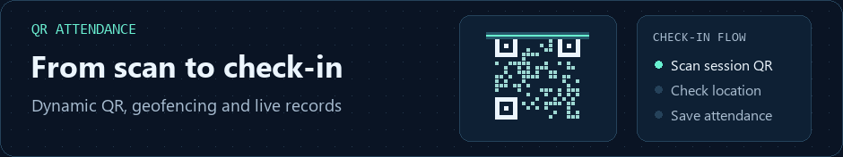

  

  <a href="#selected-projects"><strong>Projects</strong></a> &nbsp;·&nbsp;
  <a href="#toolkit"><strong>Toolkit</strong></a> &nbsp;·&nbsp;
  <a href="https://linkedin.com/in/divyamtech35"><strong>LinkedIn ↗</strong></a> &nbsp;·&nbsp;
  <a href="mailto:divyam.tech35@gmail.com"><strong>Email ↗</strong></a>

I’m Divyam, a B.Tech Computer Science student in Gandhinagar, Gujarat. I build web and mobile applications that bring interfaces, APIs, and databases together. My work spans classroom attendance, regional mapping, and team management.

## Selected projects

### QR Attendance System

`React` · `Next.js` · `React Native` · `Node.js` · `Express.js` · `MySQL`

- Built a faculty portal for scheduling classes, opening attendance sessions, importing Excel rosters, and tracking check-ins live.
- Combined five-second QR rotation, geofencing, and device fingerprinting for check-in verification.
- Added bulk enrollment, student account activation, and attendance analytics.

### GIS Management System

`Python` · `Django` · `MySQL` · `Folium` · `Chart.js`

- Built a responsive map to find schools and hospitals by state, district, and taluka using Google Maps and OpenStreetMap.
- Implemented Django login and registration and used MySQL to manage geographic and user data.

### WDC Portal

`Node.js` · `Express.js` · `TypeScript` · `Appwrite` · `MongoDB` · `OpenFGA`

- Built REST APIs for creating teams, managing membership, and reviewing join requests for university innovation programs.
- Used JWT for session management and OpenFGA for fine-grained, role-based authorization.

## Toolkit

| Area | Technologies |
| :--- | :--- |
| **Languages** | C, C++, Java, Python, JavaScript, TypeScript, SQL |
| **Web & mobile** | React, Next.js, React Native, Expo, HTML, CSS, Bootstrap, Tailwind CSS |
| **APIs & data** | Node.js, Express.js, Django, MySQL, MongoDB, SQLite, Appwrite, OpenFGA |
| **Tools** | Git, GitHub, Docker, Postman, Linux, VS Code, Android Studio, ngrok |

## Experience & education

| Role or program | Organization | Dates |
| :--- | :--- | :--- |
| Web Developer Intern | Nextway Technologies Pvt. Ltd. | Jun 2024 · Six weeks |
| B.Tech in Computer Science | Pandit Deendayal Energy University | May 2025–present |
| Diploma in Computer Engineering | Government Polytechnic College, Himatnagar | May 2022–May 2025 |

**Currently exploring** · System design, cloud computing, DevOps, AI agents, and application authorization.
