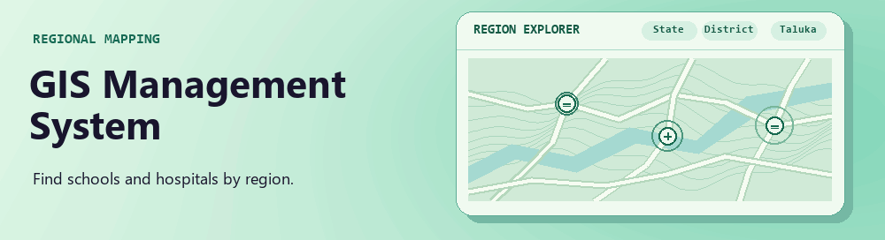

  

  <a href="https://github.com/divyamtech35-commits?tab=repositories">GitHub Repositories</a>
  &nbsp; · &nbsp;
  <a href="https://linkedin.com/in/divyamtech35">LinkedIn</a>
  &nbsp; · &nbsp;
  <a href="mailto:divyam.tech35@gmail.com">Email</a>

## About me

I'm a B.Tech Computer Science student at Pandit Deendayal Energy University. I build web and mobile applications, with an interest in how interfaces, APIs, and databases work together. My recent work includes a campus attendance system and a GIS application for exploring schools and hospitals by region.

## Featured projects

### QR-Based Attendance System

`React` · `React Native` · `Node.js` · `Express.js` · `MySQL`

- Built a faculty portal for scheduling classes, starting attendance sessions, importing student rosters from Excel, and monitoring check-ins live.
- Implemented QR codes that refresh every five seconds, geofencing that flags check-ins outside the allowed area, and device fingerprinting.
- Built an admin panel for bulk enrollment and a student registration flow that checks roll numbers and mobile numbers against college records.
- Added a student mobile app and attendance analytics.

### GIS Management System

`Python` · `Django` · `MySQL` · `GIS` · `HTML` · `CSS` · `JavaScript`

- Built an interactive map that filters schools and hospitals by state, district, and taluka.
- Implemented login and registration with Django and used MySQL to manage geographic and user data.
- Built responsive interfaces during my web development internship at Nextway Technologies. The project also uses Google Maps, OpenStreetMap, Folium, and Chart.js for mapping and visualization.

### WDC Portal

`Node.js` · `Express.js` · `TypeScript` · `Appwrite` · `MongoDB` · `OpenFGA` · `JWT`

- Built REST APIs for student team creation, team management, and join requests for university innovation programs.
- Implemented JWT session management and fine-grained, role-based authorization with OpenFGA.

## Tech stack

| Area | Tools and technologies |
| --- | --- |
| Languages | C, C++, Python, Java, JavaScript, TypeScript, SQL |
| Web and mobile | React, React Native, Expo, Next.js, HTML5, CSS3, Bootstrap, Tailwind CSS |
| Backend and data | Django, Node.js, Express.js, MySQL, MongoDB, SQLite, Appwrite, OpenFGA, JWT authentication |
| Developer tools | Git, GitHub, VS Code, Android Studio, Docker, Postman, Linux, ngrok |
| Foundations | Data structures, object-oriented programming, database management, GIS |

## Experience & education

- **Web Developer Intern · Nextway Technologies Pvt. Ltd.** — Six-week internship beginning June 2024, focused on GIS web development, authentication, and database integration.
- **B.Tech in Computer Science · Pandit Deendayal Energy University** — May 2025–present.
- **Diploma in Computer Engineering · Government Polytechnic College, Himatnagar** — May 2022–May 2025.

## Currently exploring

System design, cloud computing, DevOps, AI agents, large language models, and application authorization.
